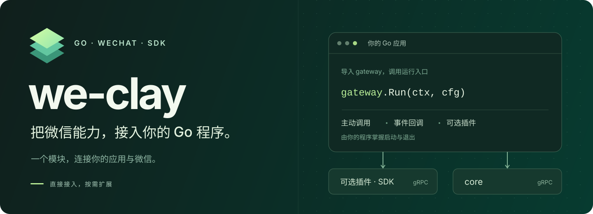
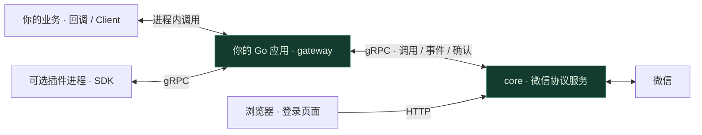

<p align="center">
  
</p>

<p align="center">
  <strong>面向 Go 开发者的微信机器人框架</strong><br />
  消息、联系人、群聊与朋友圈，从统一的 SDK 接入你的应用。
</p>

<p align="center">
  
</p>

<p align="center">
  <a href="#快速开始">快速开始</a> ·
  <a href="#能力概览">能力概览</a> ·
  <a href="docs/插件开发.md">插件开发</a> ·
  <a href="#工作方式">架构</a> ·
  <a href="#文档">文档</a>
</p>

<br />

```sh
go get github.com/we-clay/we-clay@v0.7.3
```

**导入 `gateway`，在自己的程序里调用 `gateway.Run(ctx, cfg)`。**
在同一个 Go 程序里接收消息、主动发送、操作联系人和朋友圈。通过回调取得 `Client` 即可调用业务接口；插件可选，底层微信连接由独立 core 提供。

<table>
<tr>
<td width="50%" valign="top">
<h3>融入你的 Go 项目</h3>
通过 Go Modules 引入，gateway 与 SDK 共用一个模块。无需克隆本仓库，编译应用也不需要 core 源码。
</td>
<td width="50%" valign="top">
<h3>直接写机器人逻辑</h3>
OnReady 获取客户端，OnMessage 处理消息，OnEvent 接收资料变更。需要独立扩展时再启用插件。
</td>
</tr>
<tr>
<td width="50%" valign="top">
<h3>双向 gRPC 通信</h3>
gateway 与 core 复用连接完成业务调用和事件订阅，支持事件确认、断线重连及重放。
</td>
<td width="50%" valign="top">
<h3>运行在自己的环境</h3>
Run 自动下载、校验并启动指定版本的 core。数据保留在本地。可让 core 独立常驻，应用重启后复用微信连接。
</td>
</tr>
</table>

## core 运行授权

已接入维护者自建的在线授权：core 自己检查和续期，gateway 默认通过 `WE_CLAY_AUTH_KEY` 传入 Key；多套部署可用 `Core.AuthKeyEnv` 选择各自的环境变量。we-clay v0.7.0 提供授权配置，core v0.4.0 起强制执行；旧 core 不受此机制追溯限制。参见[运行授权](docs/运行授权.md)。

## 应用重启，保留微信连接

配置 `CoreConfig.KeepAlive: true` 和固定的绝对 `DataDir`，首次运行自动下载并启动 core，后续运行复用同一进程。取消 `Run` 只断开应用；需要维护时显式调用 `gateway.StopCore(ctx, cfg)`。

完整示例与停止方法见[独立 core](docs/独立core.md)。不设置 `KeepAlive` 时，保持原来随 `Run` 退出的行为。

## 能力概览

从消息处理到社交操作，Client 与插件复用同一套 SDK 类型和业务能力。

| 领域 | 提供的接口 | SDK |
| --- | --- | --- |
| **消息与媒体** | 文字、图片、语音、视频、文件；转发、下载、撤回，支持表情包下载 | [message](sdk/message/ability.go) |
| **联系人** | 查询、备注、搜索、好友申请与验证 | [contact](sdk/contact/ability.go) |
| **群聊** | 创建、成员查询、邀请、群名、公告与管理 | [chatroom](sdk/chatroom/ability.go) |
| **朋友圈** | 时间线、指定好友主页、发布、点赞、取消点赞与评论 | [moments](sdk/moments/ability.go) |
| **插件运行** | 生命周期、事件、命令、能力注入与会话 | [plugin](sdk/plugin) |

这些是当前提供的接口，不代表每个接口都已完成真实账号验证。验证范围见[当前状态](#当前状态)。

## 快速开始

**准备：** Go 1.26+、私有 we-clay 仓库读取权限，已发布 core 的 OSS 只读凭据，以及 core v0.4.0 起所需的运行授权 Key。接入时不需要 core 源码。
安装私有模块前设置 `GOPRIVATE=github.com/we-clay/*` 并配置 GitHub 的 Git 读取凭据；凭据不要写进 go.mod 或仓库。

### 1 · 添加依赖

在自己的 Go 项目中执行。已有 `go.mod` 时跳过第一行：

```sh
go mod init example.com/my-wechat-bot
go env -w GOPRIVATE=github.com/we-clay/*
go get github.com/we-clay/we-clay@v0.7.3
```

### 2 · 调用 Run

在你自己的 `main.go` 中：

```go
package main

import (
    "context"
    "log"
    "os"
    "os/signal"
    "syscall"

    "github.com/we-clay/we-clay/gateway"
    "github.com/we-clay/we-clay/sdk/message"
)

func main() {
    ctx, stop := signal.NotifyContext(context.Background(), os.Interrupt, syscall.SIGTERM)
    defer stop()
    // 填允许自动回复的好友微信 ID 或群 ID；留空只连接、不回复。
    allowed := os.Getenv("WE_CLAY_REPLY_TO")

    err := gateway.Run(ctx, gateway.Config{
        Core: &gateway.CoreConfig{
            Version: os.Getenv("WE_CLAY_CORE_VERSION"),
            OSS: &gateway.OSSConfig{Bucket: "weclay", Region: "cn-beijing", Prefix: "core"},
            DataDir: os.Getenv("WE_CLAY_DATA_DIR"), // 必填：固定绝对路径；升级填写原账号目录
        },
    }, gateway.WithoutPlugins(), gateway.WithHandlers(gateway.Handlers{
        OnReady: func(ctx context.Context, client *gateway.Client) error {
            log.Println("微信已就绪，可以主动发送和调用朋友圈等接口")
            return nil
        },
        OnMessage: func(ctx context.Context, client *gateway.Client, msg *message.Message) error {
            self := client.Contact.GetSelf()
            if self == nil || msg.GetSender().GetUsername() == self.Username {
                return nil // 忽略当前账号自己发出的消息
            }
            if allowed == "" || msg.GetSender().GetUsername() != allowed {
                return nil
            }
            if msg.GetType().GetCode() == message.TypeText.Code && msg.GetContent() == "ping" {
                _, err := client.SendText(msg.GetSender().GetUsername(), "pong")
                return err
            }
            return nil
        },
    }))
    if err != nil {
        log.Fatal(err)
    }
}
```

将 `WE_CLAY_CORE_VERSION` 设为私有 OSS 中**实际发布的固定 tag**，然后 `go run .`。两个仓库独立版本，不要求 tag 相同。

```sh
# macOS / Linux：先确认 Actions 已完成发布 core v0.4.3
export WE_CLAY_CORE_VERSION='v0.4.3'
# 通过本机受信任的环境配置提供 WE_CLAY_AUTH_KEY（运行授权 Key）
# 通过本机受信任的环境配置提供 OSS_ACCESS_KEY_ID / OSS_ACCESS_KEY_SECRET（只读权限）
# 填你已有账号目录的绝对路径；新部署才选择新目录
export WE_CLAY_DATA_DIR='/absolute/path/to/existing/core-data'
go run .
```

`Run` 会下载当前平台的二进制、校验 SHA-256、启动 core，并等待登录。
打开 [localhost:8086](http://127.0.0.1:8086) 完成 Mac 扫码；登录成功并完成事件订阅后触发 `OnReady`，随后通过 `OnMessage` 接收消息。
后续启动复用本地缓存，并尝试恢复已有会话。按 Ctrl+C 会清理插件及本次启动的 core 子进程，保留账号状态。

<details>
<summary>缓存、私有附件与已有 core</summary>

- 二进制保存在 `runtime/core-bin/`，账号状态和 core 日志保存在显式指定的 `Core.DataDir`，均应排除 Git。
- 私有 OSS 使用只读环境凭据；详细配置见 [OSS 下载](docs/OSS下载.md)。旧 GitHub 下载方式仍使用 `WE_CLAY_GITHUB_TOKEN`。
- 已独立运行 core 时，省略 `Core`，改填 `CoreAddress`；该模式要求 core 先完成登录，Run 不管理其进程。
- 版本必须已经发布，不能填 `latest`。OSS 清单尚未发布时，Run 会明确返回下载错误。
- 附件格式与发布步骤见 [core 发布指南](docs/core发布.md)。

</details>

完整配置、超时、会话恢复与停止规则见[运行指南](docs/运行指南.md)。自动回复示例不需要插件目录或插件二进制。

### 3 · 主动发送与朋友圈

下面代码在 `OnReady` / `OnMessage` 回调内，或取得客户端后的业务函数中执行：

```go
// client 是回调传入的 *gateway.Client；receiver 是微信 ID / 群 ID。
sent, err := client.SendText(receiver, "你好")

// momentID 是从朋友圈列表或详情取得的 uint64 ID。
liked, err := client.Moments.Like(momentID)
unliked, err := client.Moments.Unlike(momentID)
```

每次调用都应单独处理 `err`；朋友圈还应检查返回值的 `BaseResult`。以上是接口示意，不要把点赞和取消点赞当作必须连续执行的步骤。
完整的[直接接入指南](docs/直接接入.md)包含主动调用、图片发送、朋友圈点赞及后台任务示例。

### 4 · 撤回消息

使用发送回执中的 `NewId`，在同一次 Run 中调用：

```go
sent, err := client.SendText(receiver, "测试撤回")
if err != nil { return err }
_, err = client.Message.Revoke(receiver, sent.GetNewId())
return err
```

以上片段放在返回 `error` 的业务函数或回调中。**v0.7.2 搭配 core v0.4.1** 已在 Mac 模式真机验证文字、位置、名片、图片、语音、视频、文件、链接及动态表情包的发送后撤回。gateway 自动保存和传递原始回执。重启或回执缺失后不能仅凭消息 ID 撤回；微信内置小表情可以作为 `[旺柴][破涕为笑]` 这样的文字发送并按文字消息撤回。详见[撤回示例与限制](docs/直接接入.md#发送后撤回完整函数)。

### 5 · 可选：加入插件

普通机器人推荐直接 Client。需要独立加载、启停多个功能模块或分别配置能力权限时，再使用插件。插件以独立进程运行，便于独立交付；具有当前系统用户权限，不是安全沙箱。

需要插件时移除 `gateway.WithoutPlugins()`；直接回调和插件可以同时使用。插件导入同一模块下的 SDK：

```go
import (
    "github.com/we-clay/we-clay/sdk/plugin"
    "github.com/we-clay/we-clay/sdk/message"
    "github.com/we-clay/we-clay/sdk/contact"
)
```

将插件编译为 `we-clay-plugin-名称`，放入 `PluginsDir`，启动前准备该目录下的 `config.toml`。
从[最小插件](docs/插件开发.md#最小插件)开始，或查看[完整示例](examples/plugin)。

<details>
<summary>直接安装示例插件，无需克隆仓库</summary>

以下命令适用于 macOS / Linux：

```sh
mkdir -p runtime/gateway/plugins
GOBIN="$PWD/runtime/gateway/plugins" go install github.com/we-clay/we-clay/examples/plugin@v0.7.3
mv runtime/gateway/plugins/plugin runtime/gateway/plugins/we-clay-plugin-example
```

把[插件配置模板](configs/plugins.example.toml)保存为 `PluginsDir/config.toml`，再启动 gateway。
模板默认禁用示例；启用前填写测试白名单，并阅读[示例的消息回复行为](examples/plugin/README.md)。
未配置的插件默认启用。需要使用管理命令时，在本地配置中填写管理者 `Owner`。

</details>

## 工作方式



| 组件 | 职责 | 运行方式 |
| --- | --- | --- |
| **gateway** | 管理 core、提供 Client 与回调、可选加载插件 | 嵌入你的 Go 应用 |
| **SDK** | 业务类型、能力接口与插件通信封装 | 编译进你的程序或插件 |
| **core** | 微信协议、登录与底层会话 | 独立二进制服务 |

gateway 与 core 统一使用 gRPC，默认端口 `8088`。浏览器登录页面由 core 的 HTTP `8086` 提供。
协议、确认语义及重连策略见[gRPC 通信](docs/gRPC通信.md)。

## 多套独立运行

同一个程序可以启动多次，每套各用独立的 core gRPC 端口、登录页端口和账号/gateway 数据目录。8086/8088 只是默认值，无需新增实例管理 API。见[两套完整配置与启动示例](docs/多套运行.md)。

## 私有 OSS 分发

`Core.OSS` 指定私有 Bucket，Run 自动签名下载固定版本并验证 SHA-256；凭据仅从环境读取。见[OSS 配置、权限与升级](docs/OSS下载.md)。

## 文档

| 开始使用 | 开发与维护 |
| --- | --- |
| [直接接入](docs/直接接入.md) · 收发消息、朋友圈、主动任务 | [迁移说明](docs/迁移说明.md) · 升级兼容性 |
| [运行指南](docs/运行指南.md) · 配置、启动、退出与排错 | [开发指南](docs/开发指南.md) · 构建、测试与协议生成 |
| [插件开发](docs/插件开发.md) · 从最小插件到能力注入 | [通信协议](docs/gRPC通信.md) · 调用、事件与确认 |
| [完整示例](examples/plugin/README.md) · 事件、命令与会话 | [迁移说明](docs/迁移说明.md) · 版本与结构调整 |
| [配置模板](configs) · 无凭据的本地配置示例 | [core 发布](docs/core发布.md) · 二进制与版本 |

凭据、运行数据与提交边界见[敏感信息管理](SECURITY.md)。

<details>
<summary>源码结构与本地开发命令</summary>

```text
we-clay/
├── go.mod              # 唯一 Go 模块
├── gateway/            # Run、Config、LoadConfig
│   └── internal/       # 连接、缓存、能力实现与插件管理
├── sdk/                # 业务模型、能力接口及插件协议
├── proto/              # protobuf / gRPC 定义
├── examples/plugin/    # 插件示例
├── configs/            # 配置模板
└── docs/               # 中文文档
```

维护者在仓库根目录执行：

```sh
make build
make example
make test
make vet
```

SDK 不依赖 gateway 内部实现，上层编译不依赖 core 源码。整个仓库共用根目录一个 `go.mod`。

</details>

## 当前状态

**v0.5.5 增加独立 core 与表情包下载**：`KeepAlive` 保留 core 进程，`StopCore` 显式停止；`Message.Download` 统一处理微信表情 CDN。见[独立 core](docs/独立core.md)与[媒体下载](docs/媒体下载.md)。

**v0.7.0 更新：** 接入 core 运行授权 Key、支持每套实例选择不同环境变量，并检测独立 core 的 Key 变更。详见[运行授权](docs/运行授权.md)。

**v0.7.3 更新：** 区分文件上传通知与完成消息；上传中明确拒绝下载。已完成附件按需分块读取，大文件走 core v0.4.3 的 CDN 路径，校验明文长度和 MD5。实测 769,693 B 与 294,168,750 B 文件经 SDK 到 core 全链路下载，见[媒体下载](docs/媒体下载.md)。

**v0.7.2 更新：** 移除 SDK 中的静态内置表情名称目录，展示用映射及图片由应用前端自行管理。

**v0.7.1 更新：** 补齐媒体撤回所需的原始回执；搭配 core v0.4.1，文字、位置、名片、图片、语音、视频、文件、链接、动态表情包均完成发送后撤回的手机验收。

**v0.6.0 更新：** 支持私有 OSS 下载、设备名称配置和会话失效通知/显式重登。多套程序通过不同端口与目录独立运行。 托管模式现在要求 `Core.DataDir` 为固定绝对路径，支持结构化 core 错误，系统发送者缓存未命中时仍保留用户名。设备/限制修正需要配套新 core，旧 Release 不会自动升级。见[设备与限制处理](docs/设备与限制处理.md)。

**v0.5.4 接通朋友圈留言与回复**，提供[真机试用示例](docs/直接接入.md#给指定朋友圈留言或回复)。头像上传自 v0.5.3 起接通；这两项均完成离线验证，待真机验收。此前接口修复见[接口契约核对](docs/接口契约核对.md)。

**13 个能力域，128 个 SDK 方法：54 个已接通，74 个仅保留占位。**
另提供 `client.SendText` 和 `client.SendCard` 便捷入口；插件和直接 Client 复用同一份能力实现。

- **历史真机记录**：Mac 模式下，核心链路已测试消息媒体、联系人、群聊、标签、朋友圈等操作，具体范围见下表后的说明。
- **本次验证**：离线竞态测试覆盖 SDK 与进程生命周期。macOS ARM64 搭配 core v0.3.1 实测应用退出后微信保持在线、重启复用同一 core，设备文件未改变；图片、视频与动态表情下载正常。没有因此发送微信消息或操作好友、群聊及朋友圈。
- **验收边界**：历史核心链路成功不等于本次完整的 Client → gateway → 发布版 core 链路已逐项真机复验。“已接通”也不代表所有参数组合可用。
- **占位行为**：保留 SDK/proto 签名，方法体只返回 `ErrNotImplemented`，不发送业务请求。直接调用用 `errors.Is(err, gateway.ErrNotImplemented)` 判断；独立插件跨 gRPC 后用 `status.Code(err) == codes.Unimplemented` 判断。

<details>
<summary>展开全部接口：已接通与待实现清单</summary>

<!-- capabilities:start -->
| Client 字段 | 已接通的方法 | 保留占位的方法 |
| --- | --- | --- |
| `Message` · 消息 | `Send`、`Forward`、`Revoke`、`Download` | — |
| `Contact` · 联系人 | `Get`、`List`、`GetSelf`、`SetRemark`、`AddFriend`、`VerifyFriend`、`Search`、`GetOwner` | `Delete`、`BlacklistAdd`、`BlacklistRemove` |
| `Chatroom` · 群聊 | `Create`、`GetInfo`、`GetQRCode`、`InviteMember`、`SetName`、`SetAnnouncement`、`SetRemark`、`Save`、`SetAdmin`、`ListMembers`、`GetMember`、`GetMembersDetail` | `FacingCreate`、`AddMember`、`RemoveMember`、`RemoveAdmin`、`TransferOwner`、`Quit`、`ScanJoin`、`ScanJoinEnterprise`、`ConsentJoin` |
| `Moments` · 朋友圈 | `Timeline`、`UserPage`、`Detail`、`Comment`、`Like`、`Unlike`、`Post`、`Upload`、`Sync` | `Delete`、`DeleteComment`、`SetPrivacy` |
| `CDN` · 媒体 CDN | `UploadImage`、`UploadVideo`、`DownloadImage`、`DownloadVideo`、`UploadMomentsImage`、`DownloadVideoCover` | `UploadMomentsVideo`、`DownloadMomentsVideo` |
| `Favor` · 收藏 | `GetInfo`、`Sync` | `GetItem`、`Delete` |
| `Label` · 标签 | `List`、`Add`、`Delete`、`Update`、`ModifyContactLabels` | — |
| `Login` · 登录 | — | `Login`、`Init`、`Refresh`、`Wakeup`、`Logout`、`PasswordLogin` |
| `Miniapp` · 小程序 | `GetRecord` | `JSLogin`、`QrcodeAuthLogin`、`GetRuntimeSession`、`GetSessionQRCode`、`OperateWxData`、`CloudCallFunction`、`SendVerifyCode`、`CheckVerifyCode`、`AddMobile`、`DelMobile`、`GetAllMobile`、`GetRandomAvatar`、`AddAvatar`、`UploadAvatarImg`、`AddRecord`、`GetUserOpenID`、`OauthSdkApp`、`ThirdAppGrant` |
| `Official` · 公众号 | — | `Follow`、`Quit`、`MpGetA8Key`、`JSAPIPreVerify`、`OauthAuthorize`、`ReadArticle`、`LikeArticle` |
| `Payment` · 支付 | — | `GeneratePayQCode`、`GetBandCardList`、`CreateHongBao`、`ReceiveHongBao`、`OpenHongBao`、`GrabHongBao`、`QueryHongBaoDetail`、`QueryHongBaoList`、`CreatePreTransfer`、`ConfirmPreTransfer`、`CollectMoney` |
| `Report` · 状态通知 | `StartTyping`、`StopTyping` | `ReadMessage` |
| `User` · 当前账号 | `GetProfile`、`GetQRCode`、`GetSafetyInfo`、`GetBoundHardDevices`、`UploadAvatar` | `UpdateProfile`、`SetPrivacy`、`SetAlias`、`VerifyPassword`、`SetPassword`、`SendVerifyMobile`、`BindMobile`、`BindEmail`、`SendVerifyEmail`、`DelSafeDevice`、`ReportMotion`、`GetCert` |
<!-- capabilities:end -->

</details>

### 历史实测范围

| 领域 | 已有证据与剩余限制 |
| --- | --- |
| 消息 | 文字/图片/语音/视频/文件、@、链接、名片、位置及转发；上述九类发送后撤回已逐项手机验收，转发消息的撤回仍需单独验证。 |
| 联系人 | 查询、保留好友关系的备注修改、群来源好友申请及接受申请已在历史 Mac 会话读回；GetOwner 为本地配置查询。 |
| 群聊 | 建群、查询、邀请及入群读回、群名/公告/备注/通讯录保存、设置管理员有历史验收；缓存和适配层仍需当前版本真机复验。 |
| 朋友圈 | 历史通过纯文字/单图发布、列表/详情、点赞/取消点赞及同步；评论与回复已接通，待真机验收；其他发布类型和部分权限参数未完整验证。 |
| 媒体 CDN | 聊天图片/视频/封面往返字节一致、朋友圈图片上传通过；朋友圈视频上传曾返回 -5103015。 |
| 收藏 | 仅容量和空列表同步通过；单项详情及删除未测。 |
| 标签 | 完整标签生命周期及好友标签读回、恢复通过。 |
| 登录 | Run 已负责 Mac 登录等待和会话恢复；单独调用这些登录方法未逐项验收，保留占位。 |
| 小程序 | 仅使用记录查询通过；其他接口缺少测试 appID 或未测。 |
| 公众号 | 没有完整真实验收，保留占位。 |
| 支付 | 没有真实验收，保留占位。 |
| 状态通知 | 开始/停止输入仅收到成功回执，未手机观察；已读通知未测。 |
| 当前账号 | 资料、个人二维码、安全设备/绑定硬件查询有历史验收；头像上传已接通并完成离线验证，待真机验收；其他资料/安全写操作保留占位。 |

**消息类型也有边界：**

- 已接通文字、@、图片、语音、视频、文件、链接、位置、动态表情包；名片使用 `client.SendCard`。动态表情包及内置小表情的发送和撤回已手机确认；“正在输入”仍仅收到成功回执，未完整手机验收。
- 转发支持收到的图片、视频和文件；其他已支持发送的类型可按模型重发。下载支持图片、视频、语音和文件。收到的文件为 `TypeAppFileAttach`，发送本地文件为 `TypeFile`。
- 小文件发送/转发曾在手机确认可打开；图片与文件下载做过字节校验，视频做过解码检查，语音下载仅检查长度与 SILK 格式。更大的附件及各种客户端组合仍待复验。
- 通用应用消息、聊天记录、音乐等未验证发送类型返回占位错误。朋友圈纯文字/单图历史发布成功；朋友圈视频上传曾失败，当前保留占位。

**运行边界：** 每进程一个活动 gateway，同一 core 一个事件订阅者。事件去重为内存状态，业务需要持久化处理重放。
core v0.3.0 的 macOS ARM64 附件已验证下载、校验、启动、gRPC 鉴权和二维码生成；本轮没有扫码。
完整调用示例见[直接接入](docs/直接接入.md)，机器可读清单见 [capabilities.json](gateway/capabilities.json)。

令牌与账号状态仅保存在本地，插件只加载可信程序。部署与提交要求见 [SECURITY.md](SECURITY.md)。

---

<p align="center">
  <strong>we-clay</strong> · 采用 <a href="LICENSE">MIT License</a><br />
  基于 sbgayhub 的原始项目及前期整理版本，保留原作者署名。
</p>

## 掉线通知与重新登录

`Handlers.OnConnectionChanged` 接收 core 的登录状态变化；微信会话离线后，Run 返回 `gateway.ErrLoginRequired`，旧 Client 停用。重新连接时由 gateway 请求 core 完成重登，应用无需实现微信认证。详见[三层职责与完整流程](docs/掉线通知与重新登录.md)。需要 we-clay v0.6.0 及以上与 core v0.3.3 及以上 配套使用。

## 自定义设备名称

通过 `gateway.CoreConfig.DeviceName` 或 `[core].device_name` 指定名称，例如“我的 Mac 机器人”。留空沿用已有设备名称；更改后重启 core 生效，设备 ID 与账号目录保持不变。需使用 we-clay v0.6.0 及以上与 core v0.3.3 及以上 配套构建。见[设备名称配置](docs/运行指南.md#自定义设备名称)。
