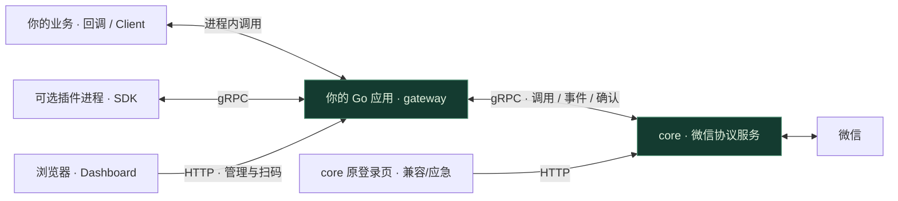

<p align="center">
  
</p>

<p align="center">
  <strong>面向 Go 开发者的微信机器人框架</strong><br />
  消息、联系人、群聊与朋友圈，从统一的 SDK 接入你的应用。
</p>

<p align="center">
  
</p>

<p align="center">
  <a href="#快速开始">快速开始</a> ·
  <a href="#一键安装">一键安装</a> ·
  <a href="#能力概览">能力概览</a> ·
  <a href="docs/插件开发.md">插件开发</a> ·
  <a href="#工作方式">架构</a> ·
  <a href="#文档">文档</a>
</p>

<br />

想编写自己的 Go 机器人或插件时，再引入私有 SDK：

```sh
go get github.com/we-clay/we-clay@v0.10.0
```

**直接安装预编译程序，或导入 `gateway` 在自己的 Go 程序里调用 `gateway.Run(ctx, cfg)`。**
两种方式使用同一套 Dashboard、AI、SDK 和 core 通信实现。需要自己编写机器人逻辑时，通过回调取得 `Client` 调用业务接口；底层微信连接由独立 core 提供。

<table>
<tr>
<td width="50%" valign="top">
<h3>一键启动或融入 Go 项目</h3>
预编译程序包含 Dashboard、AI 和网页资源；开发者仍可通过 Go Modules 导入 gateway 与 SDK。两种方式都不需要 core 源码。
</td>
<td width="50%" valign="top">
<h3>直接写机器人逻辑</h3>
OnReady 获取客户端，OnMessage 处理消息，OnEvent 接收资料变更。需要独立扩展时再启用插件。
</td>
</tr>
<tr>
<td width="50%" valign="top">
<h3>双向 gRPC 通信</h3>
gateway 与 core 复用连接完成业务调用和事件订阅，支持事件确认、断线重连及重放。
</td>
<td width="50%" valign="top">
<h3>运行在自己的环境</h3>
Run 自动下载、校验并启动指定版本的 core。数据保留在本地。可让 core 独立常驻，应用重启后复用微信连接。
</td>
</tr>
</table>

## 一键安装

正式发布的安装脚本按系统下载已编译的 `we-clay` 主程序；主程序使用同一授权 Key 自动下载、校验并启动独立 core。使用者无需安装 Go、读取私有源码或领取 OSS AK/SK。脚本和二进制从私有 OSS 提供，下载前由[授权服务](docs/一键安装.md)签发短时链接。首次安装需要在终端输入授权 Key，或传入授权文件路径。
安装过程会提示当前阶段和主程序下载进度；安装目录可用 `--data-dir` 指定，原微信账号目录使用 `--core-data-dir` 指定。省略 `--key-file` 时会在终端安全提示输入授权 Key；可用 `--device-name` 指定微信中显示的设备名称。设备平台默认 `mac`；新 Windows 设备可用 `--device-type win`（PowerShell 为 `-DeviceType win`），须配套支持该模式的 core 和独立新账号目录，见[Windows 设备信息](docs/运行指南.md#windows-设备信息)。Windows 模式初轮真机验收未通过，出现会话失效及用户报告的手机主设备退出，实验实例已停止；详见 core PR #5。

**macOS / Linux：**

```sh
curl -fsSL https://nww.hihfy.com/we-clay-auth/install.sh | bash
```

**Windows PowerShell：**

```powershell
$installer = Join-Path $env:TEMP 'we-clay-install.ps1'
Invoke-WebRequest 'https://nww.hihfy.com/we-clay-auth/install.ps1' -OutFile $installer
powershell -NoProfile -ExecutionPolicy Bypass -File $installer
```

已有登录过的微信设备时，安装命令必须加 `--core-data-dir`（Windows 为 `-CoreDataDir`）指向**原 core 账号目录的绝对路径**；不要复制账号目录或重新选择新目录。示例：

```sh
curl -fsSL https://nww.hihfy.com/we-clay-auth/install.sh | bash -s -- \
  --key-file /absolute/path/to/license.key \
  --core-data-dir /absolute/path/to/existing/core-data
```

首次安装完成会启动主程序。打开 `http://127.0.0.1:8208` 创建控制台管理员，再点击“微信连接”：在同一页面查看 core 状态、启停本安装管理的独立 core、扫码登录，以及提交登录 PIN 或确认设备。停止 core 后控制台继续运行，微信设备数据保留。core 原有的 `http://127.0.0.1:8201` 登录页仍保留，供兼容调用与应急排查使用。

已安装用户可用同一安装脚本更新主程序、指定新 core 版本或更换授权 Key；先结束旧 gateway，原来使用默认安装目录的用户可省略 `--data-dir`，自定义过目录的用户必须传入原路径，需要自动重启时加 `--restart`。切换 core 版本或 Key 时，脚本通过受控的 `--stop-core` 入口停下原 core，保留微信设备和会话数据，再启动新版本。单独运行 `run.sh --stop-core`（Windows 为 `run.cmd --stop-core`）只停止本安装目录管理的 core。详见[三平台安装、授权文件、升级与多套实例](docs/一键安装.md)。

`cmd/we-clay` 只是启动入口；现有 `gateway.Run` 和 SDK 导入方式继续可用。

## core 运行授权

已接入维护者自建的在线授权：core 自己检查和续期，gateway 默认通过 `WE_CLAY_AUTH_KEY` 传入 Key；多套部署可用 `Core.AuthKeyEnv` 选择各自的环境变量。we-clay v0.7.0 提供授权配置，core v0.4.0 起强制执行；旧 core 不受此机制追溯限制。参见[运行授权](docs/运行授权.md)。

## 应用重启，保留微信连接

配置 `CoreConfig.KeepAlive: true` 和固定的绝对 `DataDir`，首次运行自动下载并启动 core，后续运行复用同一进程。取消 `Run` 只断开应用；需要维护时显式调用 `gateway.StopCore(ctx, cfg)`。

完整示例与停止方法见[独立 core](docs/独立core.md)。不设置 `KeepAlive` 时，保持原来随 `Run` 退出的行为。

## 能力概览

从消息处理到社交操作，Client 与插件复用同一套 SDK 类型和业务能力。

| 领域 | 提供的接口 | SDK |
| --- | --- | --- |
| **消息与媒体** | 文字、图片、语音、视频、文件；转发、下载、撤回，支持表情包下载；拍一拍（Mac 模式私聊与群聊已验证）；语音转文字（单条语音已真机验证） | [message](sdk/message/ability.go) |
| **联系人** | 查询、备注、搜索、好友申请与验证 | [contact](sdk/contact/ability.go) |
| **群聊** | 创建、成员查询、邀请、群名、当前账号群内显示名、公告与管理 | [chatroom](sdk/chatroom/ability.go) |
| **朋友圈** | 时间线、指定好友主页、发布、点赞、取消点赞与评论 | [moments](sdk/moments/ability.go) |
| **插件运行** | 生命周期、事件、命令、能力注入与会话 | [plugin](sdk/plugin) |

这些是当前提供的接口，不代表每个接口都已完成真实账号验证。验证范围见[当前状态](#当前状态)。
语音转文字的调用和验证边界见[语音转文字](docs/语音转文字.md)。

## 快速开始

**准备：** 这一节是源码 SDK 接入，需 Go 1.26+、私有 we-clay 仓库读取权限，以及运行授权 Key。core 从私有 OSS 下载可用同一 Key 换取短时地址；受控部署仍可使用原有 OSS 只读凭据。接入时不需要 core 源码。仅运行控制台可按上文使用预编译安装包。
安装私有模块前设置 `GOPRIVATE=github.com/we-clay/*` 并配置 GitHub 的 Git 读取凭据；凭据不要写进 go.mod 或仓库。

### 1 · 添加依赖

在自己的 Go 项目中执行。已有 `go.mod` 时跳过第一行：

```sh
go mod init example.com/my-wechat-bot
go env -w GOPRIVATE=github.com/we-clay/*
go get github.com/we-clay/we-clay@v0.10.0
```

### 2 · 调用 Run

在你自己的 `main.go` 中：

```go
package main

import (
    "context"
    "log"
    "os"
    "os/signal"
    "syscall"

    "github.com/we-clay/we-clay/gateway"
    "github.com/we-clay/we-clay/sdk/message"
)

func main() {
    ctx, stop := signal.NotifyContext(context.Background(), os.Interrupt, syscall.SIGTERM)
    defer stop()
    // 填允许自动回复的好友微信 ID 或群 ID；留空只连接、不回复。
    allowed := os.Getenv("WE_CLAY_REPLY_TO")

    err := gateway.Run(ctx, gateway.Config{
        Core: &gateway.CoreConfig{
            Version: os.Getenv("WE_CLAY_CORE_VERSION"),
            OSS: &gateway.OSSConfig{Bucket: "weclay", Region: "cn-beijing", Prefix: "core"},
            DataDir: os.Getenv("WE_CLAY_DATA_DIR"), // 必填：固定绝对路径；升级填写原账号目录
        },
    }, gateway.WithoutPlugins(), gateway.WithHandlers(gateway.Handlers{
        OnReady: func(ctx context.Context, client *gateway.Client) error {
            log.Println("微信已就绪，可以主动发送和调用朋友圈等接口")
            return nil
        },
        OnMessage: func(ctx context.Context, client *gateway.Client, msg *message.Message) error {
            self := client.Contact.GetSelf()
            if self == nil || msg.GetSender().GetUsername() == self.Username {
                return nil // 忽略当前账号自己发出的消息
            }
            if allowed == "" || msg.GetSender().GetUsername() != allowed {
                return nil
            }
            if msg.GetType().GetCode() == message.TypeText.Code && msg.GetContent() == "ping" {
                _, err := client.SendText(msg.GetSender().GetUsername(), "pong")
                return err
            }
            return nil
        },
    }))
    if err != nil {
        log.Fatal(err)
    }
}
```

将 `WE_CLAY_CORE_VERSION` 设为私有 OSS 中**实际发布的固定 tag**，然后 `go run .`。两个仓库独立版本，不要求 tag 相同。

```sh
# macOS / Linux：先确认 Actions 已完成发布 core v0.5.0
export WE_CLAY_CORE_VERSION='v0.5.0'
# 通过本机受信任的环境配置提供 WE_CLAY_AUTH_KEY（运行授权 Key）
# 默认不需要 OSS_ACCESS_KEY_ID / OSS_ACCESS_KEY_SECRET
# 填你已有账号目录的绝对路径；新部署才选择新目录
export WE_CLAY_DATA_DIR='/absolute/path/to/existing/core-data'
go run .
```

`Run` 会下载当前平台的二进制、校验 SHA-256、启动 core，并等待登录。
打开 [localhost:8201](http://127.0.0.1:8201) 完成 Mac 扫码；登录成功并完成事件订阅后触发 `OnReady`，随后通过 `OnMessage` 接收消息。
后续启动复用本地缓存，并尝试恢复已有会话。按 Ctrl+C 会清理插件及本次启动的 core 子进程，保留账号状态。

<details>
<summary>缓存、私有附件与已有 core</summary>

- 二进制保存在 `runtime/core-bin/`，账号状态和 core 日志保存在显式指定的 `Core.DataDir`，均应排除 Git。
- 私有 OSS 优先使用同一授权 Key 申请短时下载地址；保留 OSS 环境凭据作为受控部署方式。详细配置见 [OSS 下载](docs/OSS下载.md)。旧 GitHub 下载方式仍使用 `WE_CLAY_GITHUB_TOKEN`。
- 已独立运行 core 时，省略 `Core`，改填 `CoreAddress`；该模式要求 core 先完成登录，Run 不管理其进程。
- 版本必须已经发布，不能填 `latest`。OSS 清单尚未发布时，Run 会明确返回下载错误。
- 附件格式与发布步骤见 [core 发布指南](docs/core发布.md)。

</details>

完整配置、超时、会话恢复与停止规则见[运行指南](docs/运行指南.md)。自动回复示例不需要插件目录或插件二进制。

### 3 · 主动发送与朋友圈

下面代码在 `OnReady` / `OnMessage` 回调内，或取得客户端后的业务函数中执行：

```go
// client 是回调传入的 *gateway.Client；receiver 是微信 ID / 群 ID。
sent, err := client.SendText(receiver, "你好")

// momentID 是从朋友圈列表或详情取得的 uint64 ID。
liked, err := client.Moments.Like(momentID)
unliked, err := client.Moments.Unlike(momentID)
```

每次调用都应单独处理 `err`；朋友圈还应检查返回值的 `BaseResult`。以上是接口示意，不要把点赞和取消点赞当作必须连续执行的步骤。
完整的[直接接入指南](docs/直接接入.md)包含主动调用、图片发送、朋友圈点赞及后台任务示例。

### 4 · 撤回消息

使用发送回执中的 `NewId`，在同一次 Run 中调用：

```go
sent, err := client.SendText(receiver, "测试撤回")
if err != nil { return err }
_, err = client.Message.Revoke(receiver, sent.GetNewId())
return err
```

以上片段放在返回 `error` 的业务函数或回调中。**v0.7.2 搭配 core v0.4.1** 已在 Mac 模式真机验证文字、位置、名片、图片、语音、视频、文件、链接及动态表情包的发送后撤回。gateway 自动保存和传递原始回执。重启或回执缺失后不能仅凭消息 ID 撤回；微信内置小表情可以作为 `[旺柴][破涕为笑]` 这样的文字发送并按文字消息撤回。详见[撤回示例与限制](docs/直接接入.md#发送后撤回完整函数)。

### 5 · 可选：加入插件

普通机器人推荐直接 Client。需要独立加载、启停多个功能模块或分别配置能力权限时，再使用插件。插件以独立进程运行，便于独立交付；具有当前系统用户权限，不是安全沙箱。

需要插件时移除 `gateway.WithoutPlugins()`；直接回调和插件可以同时使用。插件导入同一模块下的 SDK：

```go
import (
    "github.com/we-clay/we-clay/sdk/plugin"
    "github.com/we-clay/we-clay/sdk/message"
    "github.com/we-clay/we-clay/sdk/contact"
)
```

将插件编译为 `we-clay-plugin-名称`，放入 `PluginsDir`，启动前准备该目录下的 `config.toml`。
从[最小插件](docs/插件开发.md#最小插件)开始，或查看[完整示例](examples/plugin)。

<details>
<summary>直接安装示例插件，无需克隆仓库</summary>

以下命令适用于 macOS / Linux：

```sh
mkdir -p runtime/gateway/plugins
GOBIN="$PWD/runtime/gateway/plugins" go install github.com/we-clay/we-clay/examples/plugin@v0.10.0
mv runtime/gateway/plugins/plugin runtime/gateway/plugins/we-clay-plugin-example
```

把[插件配置模板](configs/plugins.example.toml)保存为 `PluginsDir/config.toml`，再启动 gateway。
模板默认禁用示例；启用前填写测试白名单，并阅读[示例的消息回复行为](examples/plugin/README.md)。
未配置的插件默认启用。需要使用管理命令时，在本地配置中填写管理者 `Owner`。

</details>

## 工作方式



| 组件 | 职责 | 运行方式 |
| --- | --- | --- |
| **gateway** | 管理 core、提供 Client 与回调、可选加载插件 | 预编译主程序或嵌入你的 Go 应用 |
| **SDK** | 业务类型、能力接口与插件通信封装 | 编译进你的程序或插件 |
| **core** | 微信协议、登录与底层会话 | 独立二进制服务 |

gateway 与 core 统一使用 gRPC，默认端口 `8088`。Dashboard 默认在 `8208` 提供扫码；预编译安装版还可管理本安装的独立 core。core 的 HTTP `8201` 登录页继续保留，供兼容调用与应急排查使用。
协议、确认语义及重连策略见[gRPC 通信](docs/gRPC通信.md)。

## Dashboard 与 AI 基础插件

Dashboard 与 AI 是 `gateway.Run` 默认注册的内建插件，共用本地状态库、模型配置和任务执行器；无需另起 Dashboard 或 AI 服务。Dashboard 默认监听 `http://127.0.0.1:8208`。管理员可以从控制台的“微信连接”入口查看二维码和登录状态；预编译安装版还可启停本安装管理的独立 core。core 原登录页默认位于 `http://127.0.0.1:8201`。

### 能力

- **Dashboard 工作台：**查看运行状态、消息与 Token 统计；浏览会话、消息、联系人和媒体；在聊天页发送文字、图片、文件、语音及微信表情；管理模型、插件、任务、日志和控制台设置。桌面与手机布局均可使用，并支持亮色／暗色主题。
- **AI 模型中心：**配置供应商、模型和能力，分别管理对话、视觉、语音识别、语音合成、图片及视频处理流水线；使用模型实验室测试连接与任务，配置提示词、并发和预算等行为限制。支持 OpenAI 兼容接口、Gemini 和 Anthropic 的已接入能力，实际可用模型取决于供应商接口及模型本身。
- **智能洞察与自动回复：**对选定会话生成分析报告，支持流式显示和截断识别；自动回复可设置会话范围、模型、人设及行为限制。自动回复总开关默认开启，仍需启用 AI 插件、将会话设为自动并配置可用模型；默认空黑名单不排除会话。已有手动关闭设置保留。
- **内建防护：**提示词防护与上下文清洗默认注册并开启，可在插件中心调整规则、模式并离线验证。处理记录仅管理员可见；清洗不会改写原始聊天归档，也不能保证识别所有攻击。
- **扩展业务插件：**提供定时任务、消息统计、词云、好友自动通过、入群欢迎、每日摘要、新闻、视频解析、音乐、表情包、今天吃什么和摸鱼日报。通过插件中心配置，通过工作台预览、管理素材、确认发送和查看记录。真实模式下业务插件默认关闭；启用后默认空黑名单全局生效，填入名单可排除指定会话。音乐和新闻沿用内置数据源；视频解析、表情搜索等外部服务需要自行配置兼容地址。

### 启动与使用

**脱机浏览界面：**在仓库根目录运行：

```sh
make mock
```

打开 `http://127.0.0.1:8208`，即可查看页面、切换演示场景和预览工作台。Mock 使用虚构数据与独立数据库，不启动 core、不连接微信或真实模型，也不会访问真实控制台数据；首次编译可能需要 Go 依赖。按 Ctrl+C 退出。

**连接真实微信：**准备 `WE_CLAY_AUTH_KEY`，在仓库根目录运行：

```sh
make run
```

打开 `http://127.0.0.1:8208` 创建本地 Dashboard 管理员，再从“微信连接”入口扫码登录。控制台账号与微信账号的登录仍是两个独立步骤。`make run` 会启动 Mac 模式 core 并使用本地真实会话；不要把运行数据、凭据或真实聊天内容提交到仓库。若已有独立运行且已登录的 core，使用 `make attach` 启动控制台并连接它；该命令不会下载、启动或停止 core，控制台也不会接管外部 core 的进程。真实启动细节见[本机真实微信验收](docs/控制台与AI.md#本机真实微信验收)。

**嵌入自己的 Go 应用：**直接调用 `gateway.Run` 时 Dashboard 和 AI 默认启用；用选项按需关闭：

```go
gateway.Run(ctx, cfg) // 默认启用 Dashboard 与 AI
gateway.Run(ctx, cfg, gateway.WithoutDashboard()) // 关闭 Web 页面，保留 AI
gateway.Run(ctx, cfg, gateway.WithoutAI())       // 保留 Dashboard，关闭 AI
gateway.Run(ctx, cfg, gateway.WithoutExternalPlugins()) // 保留内建功能，禁止外部插件进程
```

也可在 TOML 中设置监听地址、数据目录或禁用项：

```toml
[console]
address = "127.0.0.1:8208"
data_dir = "./runtime/console"
disabled = false
disable_ai = false
```

进入“插件中心”启用并配置所需能力，再到“工作台”查看操作说明、预览任务和结果；工作台中的手动发送操作需确认，自动回复及事件插件按启用状态和名单执行。模型连接、能力支持及外部服务仍须按实际配置验证。未登录微信的页面和 Mock 成功结果只用于离线体验，不代表真实账号或供应商验收通过。

完整页面说明、配置字段、已实现范围和限制见[控制台与 AI](docs/控制台与AI.md)；完整真实启动流程见[运行指南](docs/运行指南.md)。

自动回复的模型上下文、互动元数据与可审核长期记忆见 [AI 记忆](docs/AI记忆.md)。

模型可调用的微信能力、发起人/目标授权、连续操作及后台确认见 [AI 行为与任务](docs/AI行为与任务.md)。

私聊与群聊的模型出题、多人推理、题库及失败重试见 [海龟汤插件](docs/海龟汤.md)。

点歌音源、音乐卡片与歌词见 [音乐插件](docs/音乐插件.md)；今日新闻、图卦与 RSS 推送见 [新闻插件](docs/新闻插件.md)。

## 多套独立运行

同一个程序可以启动多次，每套各用独立的 core gRPC 端口、登录页端口和账号/gateway 数据目录。8201/8088 只是默认值，无需新增实例管理 API。见[两套完整配置与启动示例](docs/多套运行.md)。

## 私有 OSS 分发

`Core.OSS` 指定私有 Bucket，Run 使用授权 Key 申请短时下载链接并验证 SHA-256；受控部署仍可使用 OSS 环境凭据。见[OSS 配置、权限与升级](docs/OSS下载.md)。

## 文档

| 开始使用 | 开发与维护 |
| --- | --- |
| [直接接入](docs/直接接入.md) · 收发消息、朋友圈、主动任务 | [迁移说明](docs/迁移说明.md) · 升级兼容性 |
| [运行指南](docs/运行指南.md) · 配置、启动、退出与排错 | [开发指南](docs/开发指南.md) · 构建、测试与协议生成 |
| [插件开发](docs/插件开发.md) · 从最小插件到能力注入 | [通信协议](docs/gRPC通信.md) · 调用、事件与确认 |
| [完整示例](examples/plugin/README.md) · 事件、命令与会话 | [迁移说明](docs/迁移说明.md) · 版本与结构调整 |
| [配置模板](configs) · 无凭据的本地配置示例 | [core 发布](docs/core发布.md) · 二进制与版本 |

凭据、运行数据与提交边界见[敏感信息管理](SECURITY.md)。

<details>
<summary>源码结构与本地开发命令</summary>

```text
we-clay/
├── go.mod              # 唯一 Go 模块
├── cmd/we-clay/         # 预编译主程序的薄启动入口
├── gateway/            # Run、Config、LoadConfig
│   └── internal/       # 连接、缓存、能力实现与插件管理
├── sdk/                # 业务模型、能力接口及插件协议
├── proto/              # protobuf / gRPC 定义
├── examples/plugin/    # 插件示例
├── configs/            # 配置模板
└── docs/               # 中文文档
```

维护者在仓库根目录执行：

```sh
make build
make example
make test
make vet
```

SDK 不依赖 gateway 内部实现，上层编译不依赖 core 源码。整个仓库共用根目录一个 `go.mod`。

</details>

## 当前状态

**v0.10.0 更新：** 增加微信语音转文字、当前账号群内显示名、自动视频封面与时长、朋友圈视频 CDN 和收藏单项接口，并贯通 `mac` / `win` 设备平台配置。新安装默认配套 core v0.5.0，已有安装需显式升级 core 并沿用原账号目录。Mac 单条语音转写与群内显示名有真机验证；Windows 初轮实验失败，后续修正尚未真机复测。完整能力、限制和升级命令见[版本说明](docs/releases/v0.10.0.md)。

**v0.9.5 更新：** 修复群聊 AI 消息合批、逐句追答和发言人混淆；发送原生 @ 与引用前核对群成员及消息所属会话，完善关键词插件触发、点歌解析和系统通知展示。升级只需更新 we-clay，已有 core 版本及微信账号目录保持不变；详见[版本说明](docs/releases/v0.9.5.md)。新发送组合完成离线测试，尚未逐项真机验收。

**v0.9.4 更新：** 控制台可启停本安装目录管理的 core 并在同一页面完成扫码与登录验证；安装器支持受控切换 core 版本和授权 Key；AI 与控制台增加长期记忆、互动插件和大附件上传配置。新安装默认配套 core v0.4.6，已有安装保留原 core 版本，升级命令见[版本说明](docs/releases/v0.9.4.md)。设备质询应答仍未实现，不应把该版本视为微信风控验证已通过。

**v0.9.2 更新：** 独立 core 复用前核对启动时的账号数据目录，防止移动目录后静默丢失消息；控制台改进会话恢复、通讯录资料入口和撤回展示。升级时继续填写运行中 core 的原启动路径，详见[版本说明](docs/releases/v0.9.2.md)。

**v0.8.0 更新：** 内建 Dashboard 与 AI 基础插件，控制台默认监听 `127.0.0.1:8208`，core 登录页默认改为 `127.0.0.1:8201`；旧端口配置升级时须核对。新增私聊和群聊拍一拍入口，搭配 core v0.4.5 使用。Mac 模式下，core HTTP 接口的私聊与群聊请求均得到微信明确成功回执，手机端确认显示；SDK/gateway 调用链完成离线验证，尚未单独真机复验。结果不确定时不自动重试。

**v0.5.5 增加独立 core 与表情包下载**：`KeepAlive` 保留 core 进程，`StopCore` 显式停止；`Message.Download` 统一处理微信表情 CDN。见[独立 core](docs/独立core.md)与[媒体下载](docs/媒体下载.md)。

**v0.7.0 更新：** 接入 core 运行授权 Key、支持每套实例选择不同环境变量，并检测独立 core 的 Key 变更。详见[运行授权](docs/运行授权.md)。

**v0.7.3 更新：** 区分文件上传通知与完成消息；上传中明确拒绝下载。已完成附件按需分块读取，大文件走 core v0.4.3 的 CDN 路径，校验明文长度和 MD5。实测 769,693 B 与 294,168,750 B 文件经 SDK 到 core 全链路下载，见[媒体下载](docs/媒体下载.md)。

**v0.7.2 更新：** 移除 SDK 中的静态内置表情名称目录，展示用映射及图片由应用前端自行管理。

**v0.7.1 更新：** 补齐媒体撤回所需的原始回执；搭配 core v0.4.1，文字、位置、名片、图片、语音、视频、文件、链接、动态表情包均完成发送后撤回的手机验收。

**v0.6.0 更新：** 支持私有 OSS 下载、设备名称配置和会话失效通知/显式重登。多套程序通过不同端口与目录独立运行。 托管模式现在要求 `Core.DataDir` 为固定绝对路径，支持结构化 core 错误，系统发送者缓存未命中时仍保留用户名。设备/限制修正需要配套新 core，旧 Release 不会自动升级。见[设备与限制处理](docs/设备与限制处理.md)。

**v0.5.4 接通朋友圈留言与回复**，提供[真机试用示例](docs/直接接入.md#给指定朋友圈留言或回复)。头像上传自 v0.5.3 起接通；这两项均完成离线验证，待真机验收。此前接口修复见[接口契约核对](docs/接口契约核对.md)。

**13 个能力域，131 个能力目录方法：67 个已接通，64 个仅保留占位。**
另提供 `client.SendText`、`client.SendCard`、`client.SendVideo` 便捷入口。表中的语音转写、群内显示名在直接模式分别调用 `client.TranscribeVoice`、`client.SetDisplayName`；插件可使用对应的新 gRPC 方法。它们作为可选扩展，不要求已有的 `message.Ability`、`chatroom.Ability` 实现新增方法。

- **历史真机记录**：Mac 模式下，核心链路已测试消息媒体、联系人、群聊、标签、朋友圈等操作，具体范围见下表后的说明。
- **本次验证**：离线竞态测试覆盖 SDK 与进程生命周期。macOS ARM64 搭配 core v0.3.1 实测应用退出后微信保持在线、重启复用同一 core，设备文件未改变；图片、视频与动态表情下载正常。没有因此发送微信消息或操作好友、群聊及朋友圈。
- **验收边界**：历史核心链路成功不等于本次完整的 Client → gateway → 发布版 core 链路已逐项真机复验。“已接通”也不代表所有参数组合可用。
- **占位行为**：保留 SDK/proto 签名，方法体只返回 `ErrNotImplemented`，不发送业务请求。直接调用用 `errors.Is(err, gateway.ErrNotImplemented)` 判断；独立插件跨 gRPC 后用 `status.Code(err) == codes.Unimplemented` 判断。

<details>
<summary>展开全部接口：已接通与待实现清单</summary>

<!-- capabilities:start -->
| 能力域 | 已接通的方法 | 保留占位的方法 |
| --- | --- | --- |
| `Message` · 消息 | `Send`、`Forward`、`Revoke`、`Pat`、`Download`、`TranscribeVoice` | — |
| `Contact` · 联系人 | `Get`、`List`、`GetSelf`、`SetRemark`、`AddFriend`、`VerifyFriend`、`Search`、`GetOwner` | `Delete`、`BlacklistAdd`、`BlacklistRemove` |
| `Chatroom` · 群聊 | `Create`、`GetInfo`、`GetQRCode`、`InviteMember`、`SetName`、`SetDisplayName`、`SetAnnouncement`、`SetRemark`、`Save`、`SetAdmin`、`ListMembers`、`GetMember`、`GetMembersDetail` | `FacingCreate`、`AddMember`、`RemoveMember`、`RemoveAdmin`、`TransferOwner`、`Quit`、`ScanJoin`、`ScanJoinEnterprise`、`ConsentJoin` |
| `Moments` · 朋友圈 | `Timeline`、`UserPage`、`Detail`、`Comment`、`Like`、`Unlike`、`Post`、`Upload`、`Sync` | `Delete`、`DeleteComment`、`SetPrivacy` |
| `CDN` · 媒体 CDN | `UploadImage`、`UploadVideo`、`DownloadImage`、`DownloadVideo`、`UploadMomentsImage`、`DownloadVideoCover`、`UploadMomentsVideo`、`DownloadMomentsVideo` | — |
| `Favor` · 收藏 | `GetInfo`、`Sync`、`GetItem`、`Delete` | — |
| `Label` · 标签 | `List`、`Add`、`Delete`、`Update`、`ModifyContactLabels` | — |
| `Login` · 登录 | — | `Login`、`Init`、`Refresh`、`Wakeup`、`Logout`、`PasswordLogin` |
| `Miniapp` · 小程序 | `GetRecord` | `JSLogin`、`QrcodeAuthLogin`、`GetRuntimeSession`、`GetSessionQRCode`、`OperateWxData`、`CloudCallFunction`、`SendVerifyCode`、`CheckVerifyCode`、`AddMobile`、`DelMobile`、`GetAllMobile`、`GetRandomAvatar`、`AddAvatar`、`UploadAvatarImg`、`AddRecord`、`GetUserOpenID`、`OauthSdkApp`、`ThirdAppGrant` |
| `Official` · 公众号 | — | `Follow`、`Quit`、`MpGetA8Key`、`JSAPIPreVerify`、`OauthAuthorize`、`ReadArticle`、`LikeArticle` |
| `Payment` · 支付 | `ReceiveHongBao`、`OpenHongBao`、`GrabHongBao`、`QueryHongBaoDetail`、`QueryHongBaoList`、`CollectMoney` | `GeneratePayQCode`、`GetBandCardList`、`CreateHongBao`、`CreatePreTransfer`、`ConfirmPreTransfer` |
| `Report` · 状态通知 | `StartTyping`、`StopTyping` | `ReadMessage` |
| `User` · 当前账号 | `GetProfile`、`GetQRCode`、`GetSafetyInfo`、`GetBoundHardDevices`、`UploadAvatar` | `UpdateProfile`、`SetPrivacy`、`SetAlias`、`VerifyPassword`、`SetPassword`、`SendVerifyMobile`、`BindMobile`、`BindEmail`、`SendVerifyEmail`、`DelSafeDevice`、`ReportMotion`、`GetCert` |
<!-- capabilities:end -->

</details>

### 历史实测范围

| 领域 | 已有证据与剩余限制 |
| --- | --- |
| 消息 | 文字/图片/语音/视频/文件、@、链接、名片、位置及转发；上述九类发送后撤回已逐项手机验收，转发消息的撤回仍需单独验证。2026-10-26 一条已收到语音经 core HTTP 和 SDK/gRPC 均取得非空转写结果，其他格式和群语音待测。 |
| 联系人 | 查询、保留好友关系的备注修改、群来源好友申请及接受申请已在历史 Mac 会话读回；GetOwner 为本地配置查询。 |
| 群聊 | 建群、查询、邀请及入群读回、群名/公告/备注/通讯录保存、设置管理员有历史验收；2026-10-26 当前账号群内显示名经 core HTTP 与直接 Client/gRPC 分别设置、读回和清空恢复成功。外部插件进程尚未单独真机复验，需配套含该接口的 core。 |
| 朋友圈 | 历史通过纯文字/单图发布、列表/详情、点赞/取消点赞及同步；评论与回复已接通，待真机验收；其他发布类型和部分权限参数未完整验证。 |
| 媒体 CDN | 聊天图片/视频/封面往返字节一致、朋友圈图片上传通过；朋友圈视频上传与下载的 SDK/gateway/core 路由仅完成离线验证。历史真机上传曾返回 -5103015，当前版本尚未真机复验。 |
| 收藏 | 2026-10-26 经 core HTTP 复验容量和空列表同步成功；单项详情与删除已接入现有 core 批量协议并通过离线回执测试，因缺少测试条目尚未真机验证。 |
| 标签 | 完整标签生命周期及好友标签读回、恢复通过。 |
| 登录 | Run 已负责 Mac 登录等待和会话恢复；单独调用这些登录方法未逐项验收，保留占位。 |
| 小程序 | 仅使用记录查询通过；其他接口缺少测试 appID 或未测。 |
| 公众号 | 没有完整真实验收，保留占位。 |
| 支付 | 红包领取/查询与确认收款已接通，未执行真实资金验收；付款及支付账户查询保留占位。 |
| 状态通知 | 开始/停止输入仅收到成功回执，未手机观察；已读通知未测。 |
| 当前账号 | 资料、个人二维码、安全设备/绑定硬件查询有历史验收；头像上传已接通并完成离线验证，待真机验收；其他资料/安全写操作保留占位。 |

**消息类型也有边界：**

- 已接通文字、@、图片、语音、视频、文件、链接、位置、动态表情包；名片使用 `client.SendCard`。动态表情包及内置小表情的发送和撤回已手机确认；“正在输入”仍仅收到成功回执，未完整手机验收。
- 转发支持收到的图片、视频和文件；其他已支持发送的类型可按模型重发。下载支持图片、视频、语音和文件。收到的文件为 `TypeAppFileAttach`，发送本地文件为 `TypeFile`。
- 小文件发送/转发曾在手机确认可打开；图片与文件下载做过字节校验，视频做过解码检查，语音下载仅检查长度与 SILK 格式。更大的附件及各种客户端组合仍待复验。
- 通用应用消息、聊天记录、音乐等未验证发送类型返回占位错误。朋友圈纯文字/单图历史发布成功；朋友圈视频上传与下载虽已接通调用链，但历史视频上传曾失败，当前版本没有真实账号成功证据。CDN 上传本身也不发布朋友圈。

**运行边界：** 每进程一个活动 gateway，同一 core 一个事件订阅者。事件去重为内存状态，业务需要持久化处理重放。
core v0.3.1 的 macOS ARM64 附件已验证下载、SHA-256 校验、缓存复用和帮助命令；本次未启动微信登录。此前 v0.3.0 已验证启动、gRPC 鉴权和二维码生成，未扫码。验证范围见 [core 发布](docs/core发布.md#已验证的组合)。
完整调用示例见[直接接入](docs/直接接入.md)，机器可读清单见 [capabilities.json](gateway/capabilities.json)。

令牌与账号状态仅保存在本地，插件只加载可信程序。部署与提交要求见 [SECURITY.md](SECURITY.md)。

---

<p align="center">
  <strong>we-clay</strong> · 采用 <a href="LICENSE">MIT License</a><br />
  基于 sbgayhub 的原始项目及前期整理版本，保留原作者署名。
</p>

## 掉线通知与重新登录

`Handlers.OnConnectionChanged` 接收 core 的登录状态变化；微信会话离线后，Run 返回 `gateway.ErrLoginRequired`，旧 Client 停用。重新连接时由 gateway 请求 core 完成重登，应用无需实现微信认证。详见[三层职责与完整流程](docs/掉线通知与重新登录.md)。需要 we-clay v0.6.0 及以上与 core v0.3.3 及以上 配套使用。

## 自定义设备名称

通过 `gateway.CoreConfig.DeviceName` 或 `[core].device_name` 指定名称，例如“我的 Mac 机器人”。留空沿用已有设备名称；更改后重启 core 生效，设备 ID 与账号目录保持不变。需使用 we-clay v0.6.0 及以上与 core v0.3.3 及以上 配套构建。见[设备名称配置](docs/运行指南.md#自定义设备名称)。

互动插件新增谁是卧底、狼人杀、阿瓦隆、剧本杀、默契测试、剧情、电台、冒险及群内容工具；见[互动插件使用说明](docs/互动插件.md)。真实模式默认关闭，秘密身份通过已确认的好友私聊发放。
