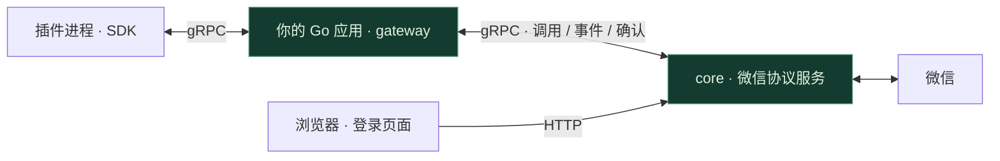

<p align="center">
  
</p>

<p align="center">
  <strong>面向 Go 开发者的微信插件框架</strong><br />
  消息、联系人、群聊与朋友圈，从统一的 SDK 接入你的应用。
</p>

<p align="center">
  
</p>

<p align="center">
  <a href="#快速开始">快速开始</a> ·
  <a href="#能力概览">能力概览</a> ·
  <a href="docs/插件开发.md">插件开发</a> ·
  <a href="#工作方式">架构</a> ·
  <a href="#文档">文档</a>
</p>

<br />

```sh
go get github.com/we-clay/we-clay@v0.4.1
```

**导入 `gateway`，在自己的程序里调用 `gateway.Run(ctx, cfg)`。**
we-clay 将连接管理、插件加载与事件分发封装为 Go 库；应用生命周期由你掌握，底层微信连接由独立 core 提供。

<table>
<tr>
<td width="50%" valign="top">
<h3>融入你的 Go 项目</h3>
通过 Go Modules 引入，gateway 与 SDK 共用一个模块。无需克隆本仓库，编译应用也不需要 core 源码。
</td>
<td width="50%" valign="top">
<h3>围绕插件扩展</h3>
插件独立运行，按需注入能力。支持事件订阅、命令处理、会话管理与配置更新。
</td>
</tr>
<tr>
<td width="50%" valign="top">
<h3>双向 gRPC 通信</h3>
gateway 与 core 复用连接完成业务调用和事件订阅，支持事件确认、断线重连及重放。
</td>
<td width="50%" valign="top">
<h3>运行在自己的环境</h3>
Run 自动下载、校验并启动指定版本的 core。数据保留在本地，context 控制完整运行周期。
</td>
</tr>
</table>

## 能力概览

从消息处理到社交操作，按业务领域组织 API，插件只需声明自己需要的能力。

| 领域 | 提供的接口 | SDK |
| --- | --- | --- |
| **消息与媒体** | 文字、图片、语音、视频、文件；转发、下载、撤回 | [message](sdk/message/ability.go) |
| **联系人** | 查询、备注、搜索、好友申请与验证 | [contact](sdk/contact/ability.go) |
| **群聊** | 创建、成员查询、邀请、群名、公告与管理 | [chatroom](sdk/chatroom/ability.go) |
| **朋友圈** | 时间线、指定好友主页、发布、评论、点赞与取消点赞 | [moments](sdk/moments/ability.go) |
| **插件运行** | 生命周期、事件、命令、能力注入与会话 | [plugin](sdk/plugin) |

这些是当前提供的接口，不代表每个接口都已完成真实账号验证。验证范围见[当前状态](#当前状态)。

## 快速开始

**准备：** Go 1.26+，以及 `core-release` 中已发布的版本。
本模块公开，可直接通过 `go get` 安装；core 源码保持私有，接入时不需要它。

### 1 · 添加依赖

在自己的 Go 项目中执行。已有 `go.mod` 时跳过第一行：

```sh
go mod init example.com/my-wechat-bot
go get github.com/we-clay/we-clay@v0.4.1
```

### 2 · 调用 Run

在你自己的 `main.go` 中：

```go
package main

import (
    "context"
    "log"
    "os"
    "os/signal"
    "syscall"

    "github.com/we-clay/we-clay/gateway"
)

func main() {
    ctx, stop := signal.NotifyContext(context.Background(), os.Interrupt, syscall.SIGTERM)
    defer stop()

    err := gateway.Run(ctx, gateway.Config{
        Core: &gateway.CoreConfig{
            Repository: "we-clay/core-release",
            Version:    os.Getenv("WE_CLAY_CORE_VERSION"),
        },
        DataDir:     "./runtime/gateway/data",
        PluginsDir:  "./runtime/gateway/plugins",
    })
    if err != nil {
        log.Fatal(err)
    }
}
```

将 `WE_CLAY_CORE_VERSION` 设为 [core-release](https://github.com/we-clay/core-release/releases) 中**实际发布的固定 tag**，然后 `go run .`。两个仓库独立版本，不要求 tag 相同。

```sh
# macOS / Linux：固定使用已发布的 core v0.3.0
export WE_CLAY_CORE_VERSION='v0.3.0'
go run .
```

`Run` 会下载当前平台的二进制、校验 SHA-256、启动 core，并等待登录。
打开 [localhost:8086](http://127.0.0.1:8086) 完成 Mac 扫码；登录成功后自动加载插件、订阅事件。
后续启动复用本地缓存，并尝试恢复已有会话。按 Ctrl+C 会清理插件及本次启动的 core 子进程，保留账号状态。

<details>
<summary>缓存、私有附件与已有 core</summary>

- 二进制保存在 `runtime/core-bin/`，账号状态和 core 日志保存在 `runtime/core/`，均应排除 Git。
- Release 仓库为私有时，通过 `WE_CLAY_GITHUB_TOKEN` 提供读取权限；不要把令牌写进配置文件。
- 已独立运行 core 时，省略 `Core`，改填 `CoreAddress`；该模式要求 core 先完成登录，Run 不管理其进程。
- 版本必须已经发布，不能填 `latest`。Release 未发布时，Run 会明确返回下载错误。
- 附件格式与发布步骤见 [core 发布指南](docs/core发布.md)。

</details>

完整配置、超时、会话恢复与停止规则见[运行指南](docs/运行指南.md)。

### 3 · 加入你的插件

插件导入同一模块下的 SDK：

```go
import (
    "github.com/we-clay/we-clay/sdk/plugin"
    "github.com/we-clay/we-clay/sdk/message"
    "github.com/we-clay/we-clay/sdk/contact"
)
```

将插件编译为 `we-clay-plugin-名称`，放入 `PluginsDir`，启动前准备该目录下的 `config.toml`。
从[最小插件](docs/插件开发.md#最小插件)开始，或查看[完整示例](examples/plugin)。

<details>
<summary>直接安装示例插件，无需克隆仓库</summary>

以下命令适用于 macOS / Linux：

```sh
mkdir -p runtime/gateway/plugins
GOBIN="$PWD/runtime/gateway/plugins" go install github.com/we-clay/we-clay/examples/plugin@v0.4.1
mv runtime/gateway/plugins/plugin runtime/gateway/plugins/we-clay-plugin-example
```

把[插件配置模板](configs/plugins.example.toml)保存为 `PluginsDir/config.toml`，再启动 gateway。
模板默认禁用示例；启用前填写测试白名单，并阅读[示例的消息回复行为](examples/plugin/README.md)。
未配置的插件默认启用。需要使用管理命令时，在本地配置中填写管理者 `Owner`。

</details>

## 工作方式



| 组件 | 职责 | 运行方式 |
| --- | --- | --- |
| **gateway** | 可选下载与启动 core、连接管理、加载插件、分发事件 | 嵌入你的 Go 应用 |
| **SDK** | 插件使用的类型、接口与通信封装 | 编译进插件 |
| **core** | 微信协议、登录与底层会话 | 独立二进制服务 |

gateway 与 core 统一使用 gRPC，默认端口 `8088`。浏览器登录页面由 core 的 HTTP `8086` 提供。
协议、确认语义及重连策略见[gRPC 通信](docs/gRPC通信.md)。

## 文档

| 开始使用 | 开发与维护 |
| --- | --- |
| [运行指南](docs/运行指南.md) · 配置、启动、退出与排错 | [开发指南](docs/开发指南.md) · 构建、测试与协议生成 |
| [插件开发](docs/插件开发.md) · 从最小插件到能力注入 | [通信协议](docs/gRPC通信.md) · 调用、事件与确认 |
| [完整示例](examples/plugin/README.md) · 事件、命令与会话 | [迁移说明](docs/迁移说明.md) · 版本与结构调整 |
| [配置模板](configs) · 无凭据的本地配置示例 | [core 发布](docs/core发布.md) · 二进制与版本 |

凭据、运行数据与提交边界见[敏感信息管理](SECURITY.md)。

<details>
<summary>源码结构与本地开发命令</summary>

```text
we-clay/
├── go.mod              # 唯一 Go 模块
├── gateway/            # Run、Config、LoadConfig
│   └── internal/       # 连接、缓存、能力实现与插件管理
├── sdk/                # 插件导入的 Go 包
├── proto/              # protobuf / gRPC 定义
├── examples/plugin/    # 插件示例
├── configs/            # 配置模板
└── docs/               # 中文文档
```

维护者在仓库根目录执行：

```sh
make build
make example
make test
make vet
```

SDK 不依赖 gateway 内部实现，上层编译不依赖 core 源码。整个仓库共用根目录一个 `go.mod`。

</details>

## 当前状态

- **已验证**：独立 Go 项目引入、编译及离线竞态测试；覆盖下载校验、缓存复用、core 子进程管理、等待登录、失败清理、缓存隔离、事件确认和重放、大文件传输。
- **运行边界**：每个进程支持一个活动 gateway，同一 core 支持一个事件订阅者。事件去重为内存状态，业务应处理重放。
- **实测组合**：core v0.3.0 · macOS ARM64，已验证真实下载、摘要校验、启动、gRPC 鉴权、二维码生成与取消后的进程回收。
- **后续验证**：本轮未扫码登录账号；登录后的插件运行及全量接口仍需继续验证。

令牌与账号状态仅保存在本地，插件只加载可信程序。部署与提交要求见 [SECURITY.md](SECURITY.md)。

---

<p align="center">
  <strong>we-clay</strong> · 采用 <a href="LICENSE">MIT License</a><br />
  基于 sbgayhub 的原始项目及前期整理版本，保留原作者署名。
</p>
